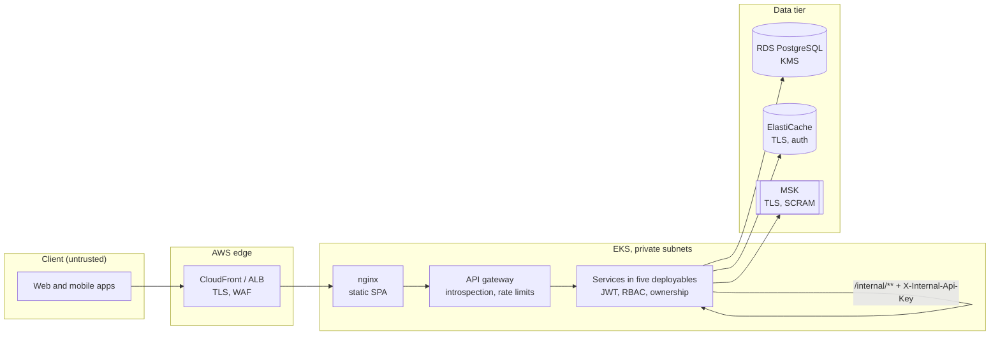

# HomeFix — Security architecture

How HomeFix protects its users, money and data: the trust boundaries, the checks every request
passes, how identities, secrets and payments are handled, and what is still open. Status as of
12 October 2026. File references point at the code that enforces each control.

## Status at a glance

| | |
|---|---|
| **Open Critical** | The committed default `JWT_SECRET` in `.env.example` is the secret that signed the token leaked in commit `1b5656d`. Any environment that reuses it accepts a SUPER_ADMIN token anyone can mint. Rotate per environment and purge the commit (section 9). |
| **Open High** | One HMAC signing key for all services; services do not check token revocation and their ports are reachable directly; no per-IP limit on password or OTP attempts; coupon caps and complaint refunds; EKS API open to the internet; every pod can read every secret; local stack published on all interfaces. |
| **Closed since the last review** | Payment callback bound to its signature; location reads check ownership; self-registration as ADMIN refused; Spring Boot 3.2 end of life (now Boot 4.1 on Java 25, the gateway on Boot 4.0 with Spring Cloud 2025.1). |

---

## 1. Trust boundaries

Nothing a client sends is trusted: identity comes only from a verified token, and amounts,
prices and ownership are always recomputed on the server.

## 2. One request, six checkpoints

The checks a request such as `GET /bookings/{id}` passes, in order:

| # | Hop | Controls | Where |
|---|-----|----------|-------|
| 1 | Client | Access JWT (15 min) kept in memory; refresh token rotated on every use, and reusing an old one revokes the whole family | `frontend/*/src/api/tokenBridge.ts`, auth-service `TokenService` |
| 2 | AWS edge | TLS at CloudFront (web apps) or the load balancer (API); WAF managed rules; security groups open only 443 and 80 | `infra/terraform/modules/waf`, `security_groups` |
| 3 | nginx | Serves only the static bundle; forwards `/api/auth/**` to auth-service and `/api/**` to the gateway | `frontend/*/nginx.conf` |
| 4 | API gateway | Rejects a missing, expired or revoked token after introspecting it with auth-service (positive answers cached up to 30 s); per-user rate limits; WAF regex on paths and parameters; HTTPS redirect; only an allow-list of paths is public | `services/api-gateway/.../JwtIntrospectionGatewayFilter.java`, `RateLimitGatewayFilter.java`, `WafInspectionGatewayFilter.java` |
| 5 | Service | Verifies the JWT again (signature, expiry), applies RBAC path rules, then checks ownership and answers 404 for someone else's record | `shared/homefix-shared-security` (`JwtValidationFilter`, `RbacEnforcementFilter`), each service's `*RbacConfig` |
| 6 | Data | KMS encryption at rest; personal fields and bank details encrypted again in the application; TLS to Redis and MSK | `modules/kms`, services' KMS adapters |

**Public paths** at the gateway (no token): `/auth/register/**`, `/auth/login/**`,
`/auth/token/refresh`, `/auth/introspect`, `/auth/password/**`, `/auth/invitations/**`,
`/payments/webhooks/razorpay`, `GET /config/client`, and health endpoints. Everything else needs a
valid token. The allow-list matches whole path segments after decoding, so `..`, encoded slashes
and look-alike prefixes resolve to protected paths (`JwtIntrospectionGatewayFilterPublicPathTest`).

**Service-to-service calls** use `/internal/**` endpoints with the shared `X-Internal-Api-Key`,
compared in constant time and failing closed when the key is unset. The gateway never routes
`/internal/**`.

## 3. Identity and sessions

| Method | How it is protected |
|--------|---------------------|
| Mobile OTP | Code hashed in Redis with a 5-minute TTL; 5 wrong tries lock the number for 30 minutes; a cap on codes per number per hour |
| Email and password | bcrypt (cost 12), timing-safe comparison, lockout after repeated failures per username, emailed codes for sign-up and reset |
| Google and Apple | ID token verified against the configured client id (`GOOGLE_CLIENT_ID`, `APPLE_SERVICES_ID`) |
| Staff accounts | By invitation only: 32 random bytes, stored as SHA-256, single use, 7-day expiry; self-registration as a staff role is refused |

**Tokens.** The access token is an HS256 JWT valid for 15 minutes. The refresh token is opaque,
valid for 30 days, stored only as its SHA-256 in Redis, and rotated on every use; presenting a used
one revokes the whole token family. Logout revokes the family; an access token stays valid until it
expires.

**Roles.** `CUSTOMER`, `SERVICE_PROVIDER`, `TENANT_ADMIN` (agency administrator) and the staff
roles `ADMIN`, `SUPER_ADMIN`, `FINANCE_ADMIN`, `DISPATCHER`, `SUPPORT_AGENT`. Each service maps
paths to roles in its `*RbacConfig`; a provider or customer only ever reaches their own records.

## 4. Data protection

- **At rest:** three KMS keys (RDS; S3, MSK and Redis; PII field-level). S3 buckets are private and
  SSE-KMS encrypted.
- **In the application:** customer names and emails and providers' bank details are encrypted with
  a data key from KMS (`KMS_PROVIDER`; locally an AES-256 key from `KMS_LOCAL_DATA_KEY`).
- **In transit:** TLS at the edge, to Redis (auth token) and to MSK (SCRAM). RDS does not yet force
  TLS (finding below).
- **Logs:** structured JSON with personal data masked; a correlation id on every request.
- **Isolation:** one database schema per service; services never read another service's tables,
  except the shared `outbox` and `config` schemas.
- **Platform settings:** `config.app_config` rows marked `exposed_to_clients` are public through
  `GET /config/client`. Never store a secret in that table, exposed or not.

## 5. Payments

- The client sends only the booking and the method; payment-service takes the amount, customer
  and provider from booking-service.
- A Razorpay payment counts only after both the HMAC of `order_id|payment_id` matches and a
  read-back from Razorpay confirms the order, the amount in paise and the currency.
- The webhook is verified over the raw body; events older than 72 hours are rejected and replays
  are idempotent. Whichever of the verify call and the webhook arrives first settles the payment.
- One wallet credit per booking, enforced by a unique index.

## 6. Secrets

| Where | How |
|-------|-----|
| Local | `.env` (never committed). Services fail at startup when a required secret (`JWT_SECRET`, `DB_PASSWORD`, `INTERNAL_API_KEY`, KMS keys) is missing. |
| Production | AWS Secrets Manager, synced by External Secrets Operator into one Kubernetes Secret per deployable (`<deployable>-secrets`); read by the pods through environment variables. |
| CI | No static AWS keys: GitHub Actions assume roles through OIDC (`AWS_CI_ROLE_ARN`, `AWS_DEPLOY_ROLE_ARN`). |

Generate every secret fresh per environment (`openssl rand -base64 48`). A value that has ever
been in the repository, including in `.env.example` or history, is burned.

## 7. Platform and supply chain

- **Containers** run as a non-root user (UID 999) on Java 25 Alpine JRE images; Kubernetes pods
  run non-root with a read-only root filesystem.
- **Images** are scanned by Trivy in CI, which fails on fixable CRITICAL vulnerabilities, before
  they are pushed to ECR.
- **Dependencies** are current: Java 25, Spring Boot 4.1, Spring Security 7, React 19, Vite 8;
  frontend lockfiles are committed.
- **Network:** in production the services sit in private subnets; only the load balancer is
  public. NetworkPolicies exist but are not yet enforced (finding below).

## 8. Open findings

| Severity | Finding | Fix |
|----------|---------|-----|
| Critical | `JWT_SECRET` in `.env.example` is the secret from the leaked commit | Rotate per environment; refuse known dev values at startup; purge `1b5656d` |
| High | One HMAC signing key is shared by every service | RS256 with JWKS; verify `iss` and `aud` |
| High | Services do not check revocation, and their ports are reachable directly | Only the gateway reachable (NetworkPolicies); a revocation deny-list |
| High | No per-IP limit on password login or OTP requests | WAF rate rule on `/auth`; CAPTCHA after failures |
| High | Coupon caps are never enforced; customers can reset their counts | Redeem server-side per booking |
| High | Complaint refunds report success but move no money | Call payment refunds; finance roles only |
| High | EKS API endpoint is open to 0.0.0.0/0 | Private endpoint, or VPN and CI ranges only |
| High | Every pod's role can read every secret, including the RDS master | One secret policy per deployable |
| High | Local stack publishes every port on 0.0.0.0; local Redis has no password | Bind 127.0.0.1; set a password |
| Medium | One `INTERNAL_API_KEY` opens every `/internal` API | Per-caller keys or mTLS |
| Medium | 30-day refresh token kept in `localStorage` | HttpOnly SameSite cookie |
| Medium | No CSP or HSTS; nginx runs as root | Security headers; nginx-unprivileged |
| Medium | `/metrics` and `/prometheus` are public on each service | A separate management port |
| Medium | Uploads trust the client's content type | Magic-byte allow-list |
| Medium | RDS does not force TLS | `rds.force_ssl = 1` |
| Medium | Stub `stripe` gateway is live and selectable; payouts are simulated | Remove the stub; real payouts with idempotency |
| Medium | IRSA roles and secrets are still keyed by the 19 old service names | One role and secret per deployable (production blocker 11) |
| Low | Actions and images pinned by tag, not by SHA or digest | Pin them |

The design deck (`docs/HomeFix_Design_Deck.pptx`, security section) has the full list with file
references, and [../CODEBASE_REVIEW.md](../CODEBASE_REVIEW.md) the original review.

## 9. Hardening plan

1. **Today — rotate:** new JWT, internal, KMS and webhook secrets in every environment; purge
   commit `1b5656d` with `git filter-repo` and force-push; add a startup check that refuses the
   example values.
2. **Identity:** RS256 with JWKS and `iss`/`aud` checks, refresh token in an HttpOnly cookie,
   per-IP limits on sign-in.
3. **Edge:** WAF on the load balancer or CloudFront, CSP and HSTS, CORS limited to the app origins.
4. **Network:** private EKS endpoint, enforced NetworkPolicies, RDS TLS.
5. **Privilege:** per-deployable IRSA roles, secret policies and internal keys; IMDSv2 on nodes.
6. **Money:** coupon redemption, real refunds and payouts, remove the stub gateway, ownership
   checks on complaints, addresses and agency enrolment.
7. **Pipeline:** SHA-pinned actions, IaC, secret and npm scans in CI.
8. **Gate:** a penetration test of staging, including the payment flow with Razorpay test keys,
   before the first real payment.

## 10. Working safely locally

- The dev SMS and email adapters write codes and links in plain text to `docker/dev-sms` and
  `docker/dev-mail`; they are off unless enabled and must never be enabled outside local.
- `DEV_SEED_ENABLED=true` creates test accounts with a known password; never set it in Helm.
- Compose publishes ports on all interfaces: on a shared network, bind them to `127.0.0.1`.
- Crash logs (`hs_err_pid*.log`) contain local paths and usernames; do not commit them.
